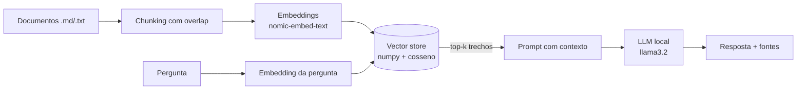

# RAG Docs QA

Assistente de perguntas e respostas sobre documentos, usando **RAG (Retrieval-Augmented Generation)** 100% local e gratuito, com [Ollama](https://ollama.com). Sem chave de API.

O sistema divide documentos em trechos, gera embeddings, recupera os trechos mais relevantes para a pergunta e pede a um LLM que responda **somente com base nesse contexto, citando as fontes**.



## Decisões de projeto

- **Vector store próprio em numpy** (similaridade de cosseno): simples, sem dependências pesadas e fácil de entender. Para volumes maiores, o próximo passo natural é trocar por FAISS, Chroma ou pgvector.
- **Modelos injetáveis** (`Embedder` e `chat_fn`): o pipeline não depende do Ollama, o que permite testar tudo offline com um embedder determinístico.
- **Prompt restritivo**: o modelo deve responder só com o contexto e dizer quando não encontrou a informação, reduzindo alucinação.
- Os documentos de exemplo em `data/docs/` são de um app de delivery **fictício**.

## Como rodar

1. Instale o [Ollama](https://ollama.com) e baixe os modelos:
   ```bash
   ollama pull nomic-embed-text
   ollama pull llama3.2
   ```
2. Instale as dependências:
   ```bash
   python -m venv .venv && source .venv/bin/activate
   pip install -r requirements.txt
   ```
3. Indexe e pergunte:
   ```bash
   python -m rag.cli index --docs data/docs
   python -m rag.cli ask "Como cancelo um pedido?"
   ```

Para usar seus próprios documentos, coloque arquivos `.md` ou `.txt` em uma pasta e aponte `--docs` para ela.

## Testes

```bash
pytest
```

Os testes cobrem chunking, vector store (busca, salvar/carregar), o fluxo completo de recuperação (com embedder falso) e os wrappers do Ollama (com um módulo `ollama` falso), então rodam sem servidor.

## Estrutura

```
rag/
  chunking.py   # divisão de texto com overlap
  store.py      # vector store (numpy) com save/load
  models.py     # wrappers do Ollama (embeddings e chat)
  pipeline.py   # indexação, recuperação e montagem do prompt
  cli.py        # comandos index e ask
tests/
data/docs/      # documentos de exemplo
```

## Próximos passos

- [ ] Avaliação da recuperação (hit rate / MRR) com um conjunto de perguntas rotuladas
- [ ] Suporte a PDF
- [ ] Reranking dos trechos recuperados
- [ ] Interface web simples (Streamlit)
